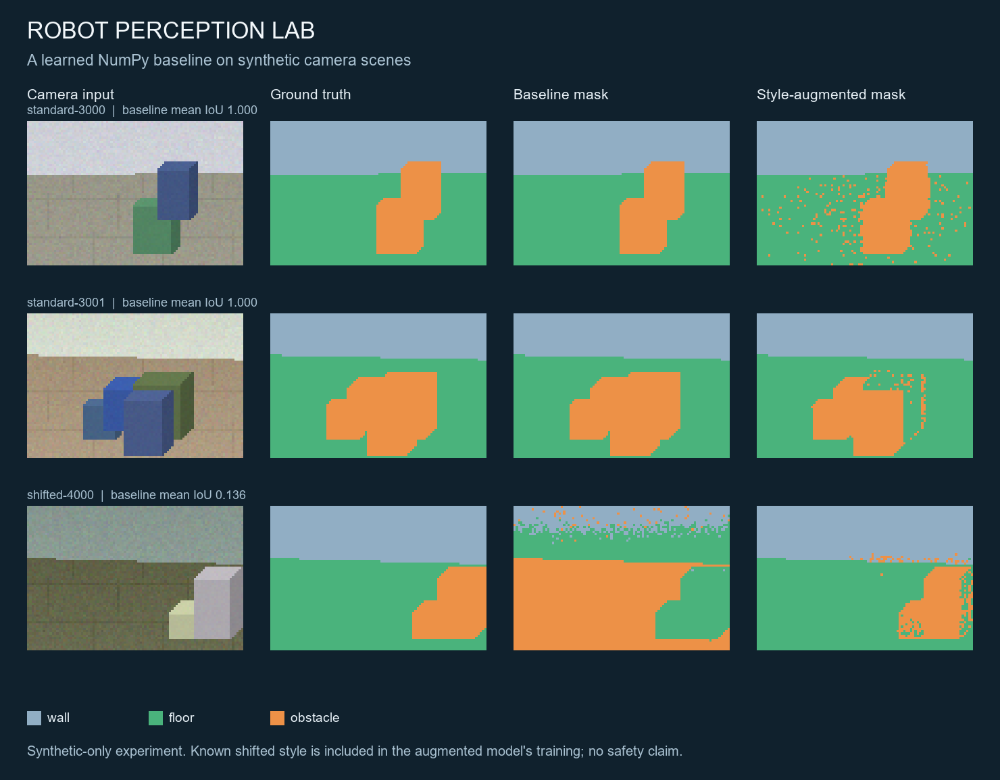
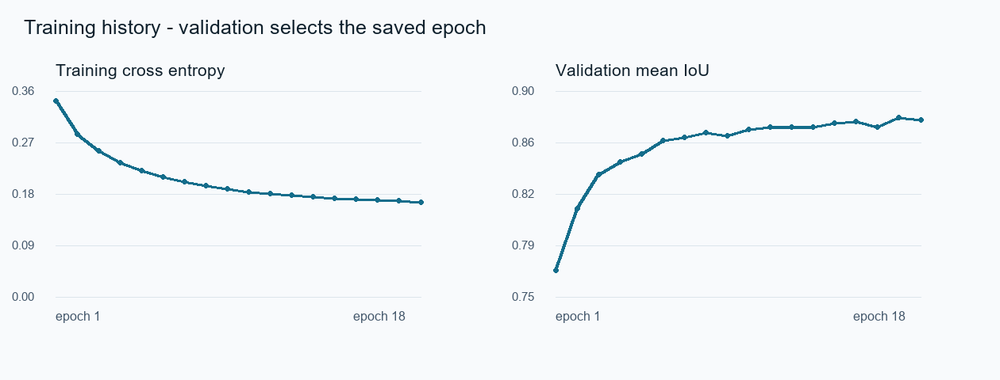

# Robot Perception Lab

**A small AI/robotics portfolio experiment about a practical failure: a model can score almost perfectly on easy synthetic images and still mistake obstacles for free space when colours change.**

This project generates camera-like indoor images with exact pixel labels, trains a NumPy classifier, measures a deliberate lighting/colour shift, and tests whether adding the known shifted style to training helps. Everything runs locally with NumPy and Pillow. It does not require robot hardware, ROS, a GPU, downloads, or an external dataset.



## Reproduce the experiment

Python 3.10+ is required. From this project directory:

```bash
python -m venv .venv
```

Activate with `.venv\Scripts\activate` on Windows or `source .venv/bin/activate` on macOS/Linux, then:

```bash
python -m pip install -r requirements.txt
python -m unittest discover -s tests -v
python -m perception_lab.demo --output results
```

The recorded run used Python **3.12.14**, NumPy **2.3.5**, and Pillow **12.3.0**. To reproduce these dependency versions, use `requirements-lock.txt`. Random seeds are fixed. Tiny floating-point differences across systems are possible; elapsed time and PNG font rendering are system dependent.

Inspect a saved example using the improved model:

```bash
python -m perception_lab.predict results/example_camera.png --model results/style_augmented_classifier.npz --output prediction.png
```

This inference command resizes to the training resolution of 96 × 64. Supplying an arbitrary photograph does not make the result reliable.

## What is actually learned?

The renderer produces three classes: **wall**, **floor**, and **obstacle**. A floor label means a synthetic pixel class, not verified traversability or clearance.

The model is multinomial logistic regression. It learns 22 × 3 parameters: 21 features plus an intercept, for each of three classes. Hand-crafted features contain RGB values, colour products, saturation, image coordinates, simple gradients, local contrast, and colour/height interactions. Standardization is fitted on training pixels only.

For each pixel, the model computes `softmax(standardized_features @ weights)` and selects the highest-scoring class. Mini-batch Adam minimizes cross entropy with L2 weight regularization. The implementation exposes the math rather than wrapping a machine-learning library. It is a classical learned baseline, not a deep network.

```text
Seeded scene renderer -> RGB images + exact masks -> scene-level split
    training scenes -> balanced pixel sample -> training-only normalization
    validation scenes -> select saved epoch by mean IoU
    untouched test scenes -> confusion matrix, IoU and floor precision/recall
```

## Data and experiment design

All images are generated in `perception_lab/data.py`; no real images or personal data are used. The camera height, boxes, textures, horizon and colours vary within a deliberately limited renderer.

| Split | Scenes | Seeds | Used for |
|---|---:|---|---|
| Standard training | 80 | 1000–1079 | Baseline and improved model fitting |
| Standard validation | 20 | 2000–2019 | Saved epoch selection |
| Standard test | 30 | 3000–3029 | Final evaluation only |
| Shifted-style test | 30 | 4000–4029 | Final evaluation only |
| Additional shifted-style training | 80 | 5000–5079 | Improved model fitting |
| Additional shifted-style validation | 20 | 6000–6019 | Improved model epoch selection |

The original model only sees the standard style. The shifted style darkens the floor and walls and makes boxes pale and less saturated. The improved model sees new scenes from both styles, using disjoint seeds. Its shifted-style evaluation therefore measures **held-out scenes of a known style**. It is not evidence of generalization to an unseen real-world domain.

Splits happen before pixel sampling. Pixels from the same image cannot leak into another split. The manifest records each scene seed and a SHA-256 digest of its RGB pixels and label mask. Tests verify disjoint seeds, scene IDs and generated images.

This is a paired educational experiment against two declared rendering styles, not a blind external benchmark. The intervention deliberately addresses the baseline's observed style failure. Once these test results have been inspected, future tuning should use a new untouched evaluation split rather than repeatedly optimizing these scenes.

## Actual measured results

The following values were generated by the checked-in code with 18 epochs per model. Each test set has 30 scenes and 184,320 pixels. Metrics pool confusion counts across the test scenes.

| Model / evaluation | Mean IoU | Pixel accuracy | Floor precision |
|---|---:|---:|---:|
| Standard-only baseline / standard test | 0.9999 | 1.0000 | 1.0000 |
| Standard-only baseline / shifted test | 0.1176 | 0.1405 | 0.1082 |
| Both-style model / standard test | 0.8763 | 0.9528 | 0.9770 |
| Both-style model / shifted test | 0.8868 | 0.9581 | 0.9415 |

The near-perfect first row reflects an easy renderer with strong colour cues; it does not establish robotics performance. The large drop under changed colours reveals that shortcut. Adding style coverage improves shifted-scene mean IoU from **0.1176 to 0.8868**, while standard-scene mean IoU falls from **0.9999 to 0.8763**. That tradeoff is retained and reported rather than hidden.

The baseline was saved at epoch 5; the model with both styles at epoch 17. The baseline used 76,744 sampled training pixels; the improved model used 153,348. Validation selects epochs; test scenes do not.

Floor precision is `true floor predicted as floor / all pixels predicted as floor`. In the improved shifted test, 5,518 obstacle pixels and 258 wall pixels are still classified as floor. Even a high aggregate score can hide an unacceptable navigation failure. This model must not control a physical robot.

Full class IoUs, confusion matrices, per-scene scores, versions and training metadata are in [metrics.json](results/metrics.json).



## Repository map

```text
perception_lab/
  data.py       seeded renderer, feature extraction, pixel sampling
  model.py      standardization, softmax, Adam, numeric model save/load
  metrics.py    confusion matrix, mean IoU, floor precision/recall
  demo.py       experiment, manifests, figures and metrics
  predict.py    single-image inference CLI
tests/          six meaningful pipeline/metric/learning tests
results/        measured outputs, figures and trained numeric weights
```

`pixel_classifier.npz` is the standard-only baseline; `style_augmented_classifier.npz` is the model with both styles. Both store numeric arrays and load with `allow_pickle=False`.

## Tests and scope

The six tests cover scene split leakage, deterministic generation, hand-calculated metric values, absent/invalid labels, learning behaviour, training-only normalization, model serialization equivalence and inference before training. The complete demonstration and all tests were run successfully.

The renderer has rectangular boxes, a simple horizon, fixed camera geometry and distinctive colour distributions. There are no people, glass, stairs, motion blur, realistic shadows, occluded geometry, depth estimates, camera calibration, temporal tracking, ROS integration or real hardware tests. Pixel accuracy is dominated by large wall/floor regions. Nearby pixels are correlated, so the pixel count is not an independent statistical sample size. No real-world accuracy or safety guarantee is claimed.

Useful next steps are a genuinely separate real-image evaluation, richer lighting/occlusion, a spatial model, uncertainty checks, per-scene confidence intervals and a comparison with a small segmentation network. They are future work, not completed capabilities.

## Portfolio honesty

This is an **AI-assisted educational portfolio project**, prepared for Nishanth Senthil Kumar. Code, documentation, tests and figures were generated with AI assistance and executed locally. A prepared repository does not demonstrate that its owner has independently mastered every component. Review and extend the experiment, reproduce the results, and use [INTERVIEW_GUIDE.md](INTERVIEW_GUIDE.md) before describing the work in an interview. Do not present it as professional experience, a deployed system, or a hardware robotics project.

MIT licensed. Synthetic data is generated by the included renderer.
